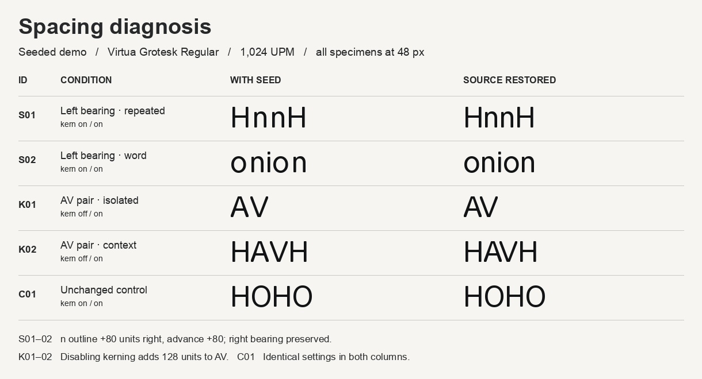

# Reviewing spacing and kerning with agents

Build the word review queue on top of a shared font-engine operation that the CLI, MCP and editor can all call.
The first version should help a designer find and fix a repeatedly bad sidebearing in an unkerned font.
Once that works, it can help find the smaller set of pairs that still need kerning.

## Example proof sheet

This example uses a copy of Virtua Grotesk Regular.
In the first two rows the left sidebearing of `n` was increased by 80 font units while the right sidebearing was retained.
In the next two rows, turning kerning off makes `AV` six pixels wider at the displayed size.
The last row uses identical settings in both columns.
The sheet was rendered independently with FreeType and RAQM from fonts compiled with ufo2ft.
Its row IDs, rendering settings, source revision and measurements are available offline. [Row measurements](examples/spacing/measurements.json)



The annotations explain the planted changes to the reader.
We also tested a [blind version](examples/spacing/blind-review.png) with the labels concealed, the rows shuffled, and two restored examples on either side.
A fresh Astra worker on low reasoning effort saw only that image.
It chose the restored spacing in each of the four changed rows and identified the unchanged row.
The trial involved two deliberately large defects, each shown twice, in a single Latin master.
It tested visual discrimination between two choices.
Finding a subtle fault without a reference, choosing the right number of font units to move and improving held-out words still need a separate trial.

## What works today

- A live editor or a Unix headless session supplies `project_info`, `glyph_inventory`, `read_glyph` and `read_kerning`.
  The last two return revisions that can guard subsequent edits.
  The headless host keeps changes in memory for the life of its process. [Agent reference](LOCAL-AI.md)
- A single `propose_edits` call can stage sidebearing changes to several glyphs in one source.
  The spacing prompt uses `translate` to move outlines, component offsets and anchors together, and `adjust_width` to change the advance.
  In a disposable copy of the Core Regular fixture, the CLI read A at 64 units on each side with an advance of 640.
  Translating by +8 and increasing the advance by 8 produced 72 left, 64 right and an advance of 648 in the proposal.
  The foreground stayed at 64/64. [Spacing prompt](../skills/runebender-spacing-pass/SKILL.md) · [Operations](../src/font/edit_batch.rs)
- `experiment_fork` and `experiment_kern` can stage positive or negative pair values, explicit zeroes and deletions.
  The pair can use individual glyphs or existing left and right groups.
  The live API can read group membership but does not offer a group creation or membership edit.
  Applying experimental kerning checks the revision of the whole root kerning table and groups, so two independently applied branches can conflict even if they worked on different pairs. [Kerning tools](../src/automation/live.rs) · [Experiment apply](../src/font/experiments.rs)
- The live `proof` tool can return drawings and numeric metrics for up to 256 named glyphs.
  The live `specimen` provides a Latin text comparison, and compiled proofs can shape specified text, features and variation locations.
  The proposal-layer proof lays glyphs out in a grid.
  The new workflow needs to shape complete words with all of the proposed spacing edits applied together in a detached copy.
  A checked-in word can guard its exported positions or its rendered appearance on every change. [Proof guide](PROJECT-PROOFS.md)

## Run a spacing scan

Choose a UFO or a master in a designspace and write one page to a fresh directory.

```sh
runebender spacing-scan tests/fixtures/core/Core.designspace --source 0 --limit 12 --out spacing-page-1
```

Open `proof.svg` to inspect the unkerned glyphs and give the worker `report.json` for the row IDs and measurements.
The score is the absolute difference in font units between one sidebearing and its reference.
Treat the direction and size of any correction as a design decision.
If the reference itself is poorly spaced, inspect its other contexts before changing the flagged glyphs.

In live MCP, call `spacing_scan` with the same source, limit and offset and set `include_sheet` to true when a worker needs the image.
Keep the snapshot and the IDs of reviewed rows with the worker's decisions.
Use `next_offset` to request another page and verify that the snapshot still matches before combining results.
If it changes, rescan the source before applying old suggestions.

In a trial on Virtua Grotesk Regular, the scanner returned two rows, one for each side of capital I.
On a disposable copy we translated lowercase h by 80 units and increased its advance by 80 units to preserve its right sidebearing.
The new left side of h ranked first with a difference of exactly 80 units against n.
The CLI and the live host produced identical JSON and SVG for the edited copy.
This trial checks detection of one known error and agreement between the two interfaces.

## Where to take the scanner next

1. **Scan the source once.** Read the project's design context, glyph categories, advances, resolved outlines, kerning groups and writing systems.
   Start with the project's own proof words and a representative corpus for each supported script.
   Rank sides that repeatedly look too tight or loose across different neighbors with kerning disabled.
   For diagnostics, combine relative sidebearings with the horizontal gap between facing outlines at several heights where both have ink.
   These measurements identify cases to inspect; the word on the page determines whether the difference suits the design.
   Preserve the special spacing rules for joining scripts, combining marks, intentional overhangs and fixed-width fonts.
2. **Send sheets with stable row IDs to the workers.** Put a dozen comparable cases on a page as a starting point.
   Each row shows the glyph or pair highlighted in a control string and in a real word, rendered at the same size and baseline for the original and candidate.
   Put the source, axis coordinates and kerning state in the header.
   Accompany the image with compact JSON keyed by row ID, holding the old metrics, proposed delta, affected glyphs or group, and source revisions.
   Use a second, larger crop only for rows a worker cannot judge at reading size.
3. **Separate reading from writing.** Give workers disjoint families of glyph sides to review against the same snapshot.
   Keep all masters of a glyph family in the same assignment when the evidence spans masters.
   One coordinator combines the suggested changes, checks revisions and creates the actual proposals.
   A worker can return “keep”, a specific edit, or “needs closer review” for each row.
   If independent agents disagree, retain both reasons with the row instead of averaging their values.
   Once basic spacing is accepted, rescan with the new advances and judge the residual pairs in words.
   For an entirely unkerned font, propose group memberships for review before generating many individual exceptions.
4. **Rerender the affected words.** Include dependent composites, class members, words outside the fitting set, and an intermediate weight when applicable.
   Keep accepted examples as project proofs.
   Verify that the comparison uses the composed candidate font with the same shaping settings as the baseline.
   Save the candidate plan, source fingerprints, completed rows and remaining work so a later run can resume from disk.
   A live experiment alone disappears when its session ends.

## An initial bounded trial

Use one disposable family whose original spacing and kerning a designer has approved.
Keep the original for comparison and introduce a known left-side error in one copy and omit kerning in another.
Include one intentionally tight pair and one clean look-alike so false positives are visible.
Start with two inexpensive vision-capable workers, one source, three sheets of twelve rows, and two review rounds.
Give every worker the same design rules and a different sheet, then send close calls to the designer or a stronger model.
For an initial experiment, try 20 minutes and 25,000 model tokens total across both workers, including image inputs in the accounting.
These are proposed ceilings to measure on the pilot.
Have the coordinator stop dispatching work when either limit is reached and save completed rows.
Compile once per candidate revision and cache sheets by font revision, text, axis location, features and render settings.
Report cases covered, faults found, false positives, accepted corrections, remaining rows, elapsed time and model usage.
Compare against the designer's review of held-out words before increasing the batch size.

The first implementation supplies bounded pages of Latin bearing comparisons and a vector proof through the CLI and live MCP.
Project word lists, optical gap scoring, automatic worker dispatch, guarded group edits and a persistent decision ledger are follow-up work.
